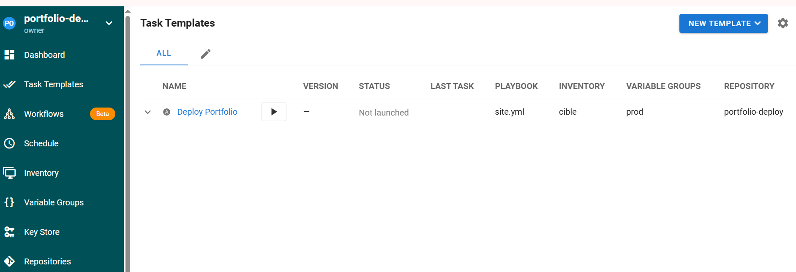
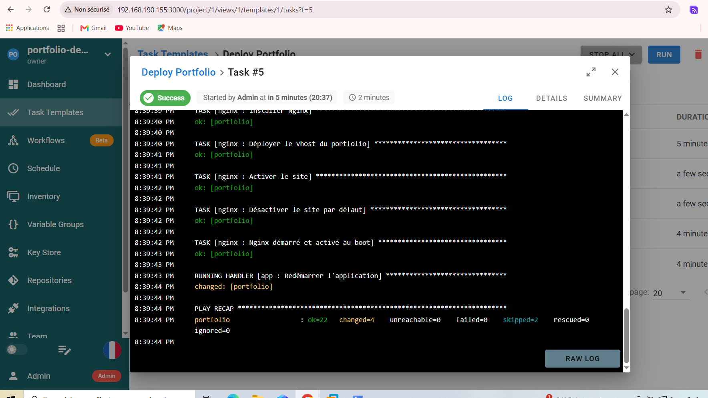
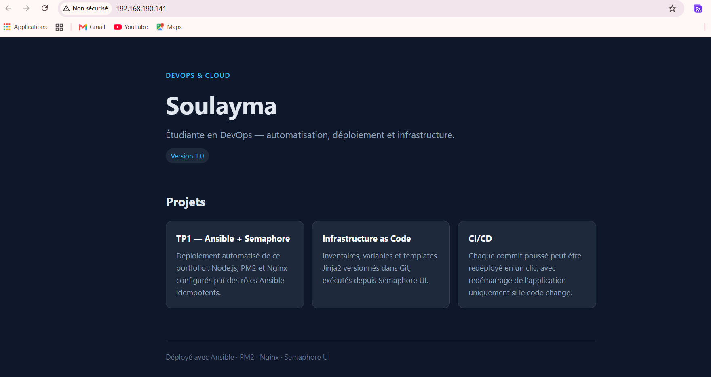

# TP1 — Déploiement d'un portfolio Next.js avec Ansible et Semaphore UI

Playbook Ansible structuré en rôles qui déploie un portfolio Next.js sur Ubuntu 24.04 :
Node.js (NodeSource) → application gérée par PM2 → Nginx en reverse proxy.
L'exécution est ensuite industrialisée avec Semaphore UI.

## Architecture

| Machine | IP | Rôle |
|---|---|---|
| `admin-ansible` | 192.168.190.155 | Poste de contrôle : Ansible, Git, Semaphore UI (Docker) |
| `automatisation` | 192.168.190.141 | Serveur cible : Node.js 22, PM2, Nginx |

Flux : Semaphore récupère ce dépôt Git → exécute `site.yml` → Ansible configure la cible en SSH (clé) →
Nginx (port 80) relaie vers l'application Next.js (port 3001).

## Structure

```
portfolio-deploy/
├── ansible.cfg
├── inventory/hosts.ini
├── group_vars/all.yml          # toutes les valeurs (aucune valeur en dur)
├── site.yml
├── requirements.yml            # collection community.general (module npm)
└── roles/
    ├── common/   apt update, git/curl/build-essential/acl, utilisateur deploy
    ├── nodejs/   dépôt NodeSource (clé signed-by), Node.js, PM2
    ├── app/      git clone, npm ci, npm run build, PM2 + handler de redémarrage
    └── nginx/    vhost Jinja2, activation du site, handler de rechargement
```

## Variables (`group_vars/all.yml`)

| Variable | Valeur | Rôle |
|---|---|---|
| `app_repo` | URL GitHub du portfolio | Dépôt cloné |
| `app_version` | `main` | Branche/tag (surchargé par le Survey Semaphore) |
| `app_dir` | `/opt/portfolio` | Dossier de l'application |
| `app_port` | `3001` | Port Next.js (3000 déjà occupé sur la cible) |
| `server_name` | `portfolio.local` | Nom du vhost Nginx |

## Utilisation en ligne de commande

```bash
ansible-galaxy collection install -r requirements.yml
ansible all -m ping
ansible-playbook site.yml --syntax-check
ansible-playbook site.yml --check --diff
ansible-playbook site.yml          # 1er déploiement
ansible-playbook site.yml          # 2e run : changed=0
```

## Idempotence

- `apt` avec `cache_valid_time` : le cache n'est rafraîchi que s'il a plus d'une heure.
- `npm ci` et `npm run build` ne s'exécutent que si le dépôt a changé (`repo.changed`) ou si aucun build n'existe.
- PM2 : `pm2 describe` (`changed_when: false`) puis `pm2 start` seulement si l'application est absente.
- Handlers : `Redémarrer l'application` (notifié par la tâche `git`) et `Recharger Nginx` (notifié par le template / le lien du site).

## Semaphore UI

Voir `GUIDE.md` à la racine du zip pour la configuration pas à pas (projet, Key Store, dépôt, inventaire,
variable group, task template, survey `app_version`).

## Captures





