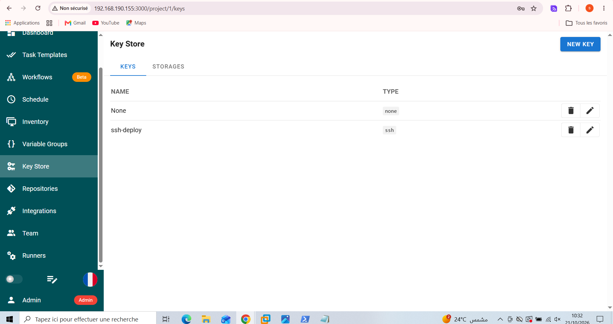
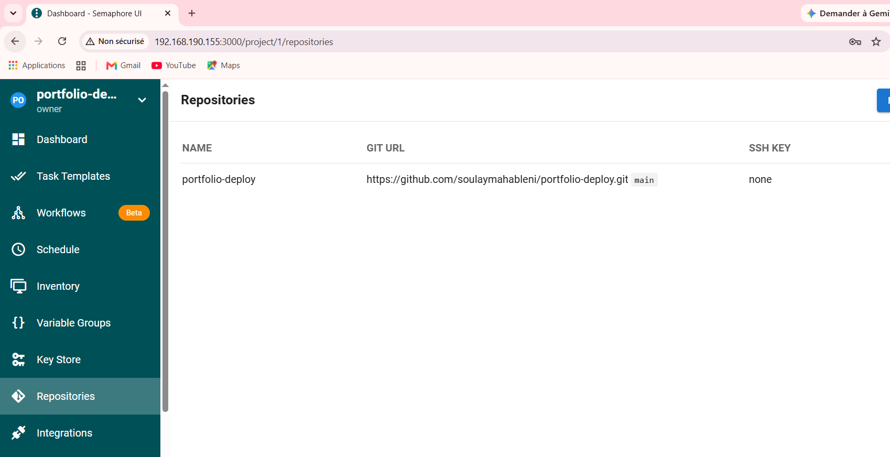
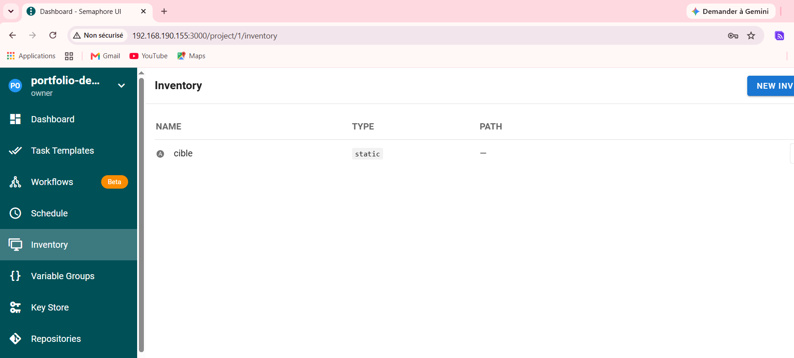
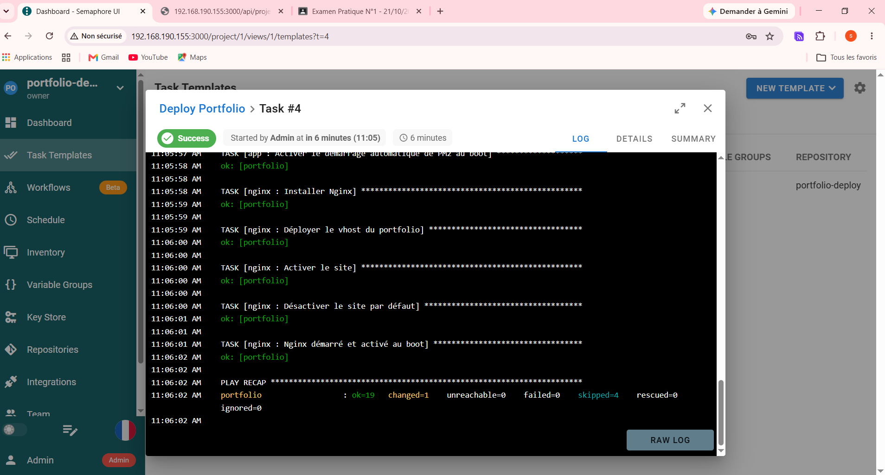

# TP1 — Déploiement d'un portfolio Next.js avec Ansible et Semaphore UI

Playbook Ansible structuré en rôles qui déploie un portfolio Next.js sur Ubuntu 24.04 :
Node.js (NodeSource) → application gérée par PM2 → Nginx en reverse proxy.
L'exécution est ensuite industrialisée avec Semaphore UI.

- Dépôt de l'application : https://github.com/soulaymahableni/portfolio-app
- Portfolio déployé : http://192.168.190.141

## Architecture

| Machine | IP | Rôle |
|---|---|---|
| `admin-ansible` | 192.168.190.155 | Poste de contrôle : Ansible, Git, Semaphore UI (Docker, port 3000) |
| `automatisation` | 192.168.190.141 | Serveur cible : Node.js 22, PM2, Nginx |

Flux : Semaphore récupère ce dépôt Git → exécute `site.yml` → Ansible configure la cible en SSH (clé ed25519,
utilisateur `deploy`) → Nginx (port 80) relaie vers l'application Next.js (port 3001).

## Structure

```
portfolio-deploy/
├── ansible.cfg
├── inventory/hosts.ini
├── group_vars/all.yml          # toutes les valeurs (aucune valeur en dur)
├── site.yml
├── roles/
│   ├── common/   apt update, git/curl/build-essential/acl, utilisateur deploy
│   ├── nodejs/   dépôt NodeSource (clé signed-by), Node.js, PM2
│   ├── app/      git clone, npm ci, npm run build, PM2 + handler de redémarrage
│   └── nginx/    vhost Jinja2, activation du site, handler de rechargement
├── captures/
└── RAPPORT.md
```

## Variables (`group_vars/all.yml`)

| Variable | Valeur | Rôle |
|---|---|---|
| `app_repo` | https://github.com/soulaymahableni/portfolio-app.git | Dépôt cloné |
| `app_version` | `main` | Branche/tag (surchargé par le Survey Semaphore) |
| `app_dir` | `/opt/portfolio` | Dossier de l'application |
| `app_port` | `3001` | Port Next.js (3000 déjà occupé sur la cible) |
| `server_name` | `portfolio.local` | Nom du vhost Nginx |

## Partie A — Exécution en ligne de commande

```bash
ansible-galaxy collection install community.general
ansible all -m ping
ansible-playbook site.yml --syntax-check
ansible-playbook site.yml --check --diff
ansible-playbook site.yml          # 1er déploiement
ansible-playbook site.yml          # 2e run : changed=0
```

### Idempotence

- `apt` avec `cache_valid_time` : le cache n'est rafraîchi que s'il a plus d'une heure.
- `npm ci` et `npm run build` ne s'exécutent que si le dépôt a changé (`repo.changed`) ou si aucun build n'existe.
- PM2 : `pm2 describe` (`changed_when: false`) puis `pm2 start` seulement si l'application est absente.
- Handlers : `Redémarrer l'application` (notifié uniquement par la tâche `git`) et `Recharger Nginx`
  (notifié par le template et le lien du site).


### Portfolio déployé


## Partie B — Industrialisation avec Semaphore UI

Semaphore est lancé en conteneur Docker sur `admin-ansible` : http://192.168.190.155:3000

| Étape | Menu | Configuration |
|---|---|---|
| 1 | Projects | `portfolio-deploy` |
| 2 | Key Store | `ssh-deploy` (SSH Key, utilisateur `deploy`) et `none` (dépôt public) |
| 3 | Repositories | `https://github.com/soulaymahableni/portfolio-deploy.git`, branche `main` |
| 4 | Inventory | `cible` (static, même contenu que `hosts.ini`, clé `ssh-deploy`) |
| 5 | Variable Groups | `prod` : `{"server_name": "portfolio.local", "app_port": 3001}` |
| 6 | Task Templates | `Deploy Portfolio` : `site.yml`, inventaire `cible`, dépôt `portfolio-deploy`, groupe `prod` |
| 7 | Survey Variable | `app_version` (branche ou tag, défaut `main`) |

### Key Store


### Repository


### Inventory


### Task Template configuré


### Exécution depuis Semaphore

Premier déploiement depuis l'interface (`failed=0`) :



Après modification de `app/page.js` dans le dépôt de l'application (Version 1.0 → 2.0) et nouveau lancement :
la tâche `git` est `changed`, le handler **Redémarrer l'application** s'exécute, puis le site affiche la nouvelle version.
Un lancement sans nouveau commit ne redémarre pas l'application (redémarrage conditionnel).


## Livrables

- Rôles complétés : `roles/`
- Captures : `captures/` (`semaphore-template.png`, `semaphore-run.png`, `portfolio.png`, `idempotence.png`)
- Rapport : [RAPPORT.md](RAPPORT.md)
